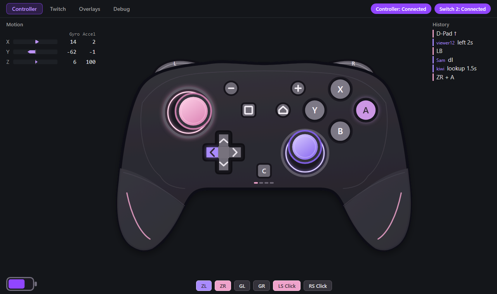
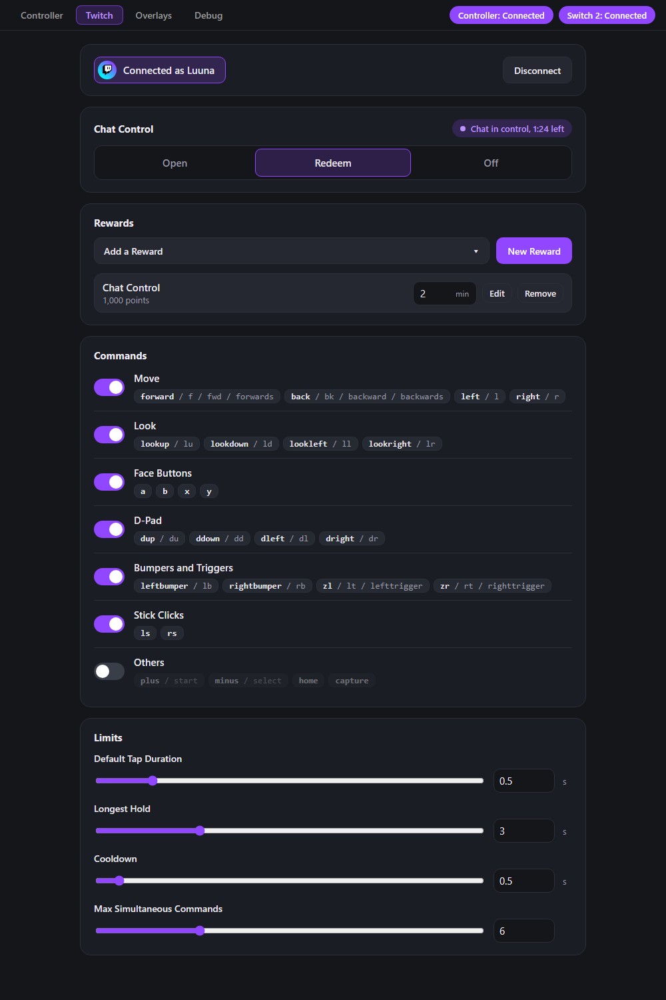
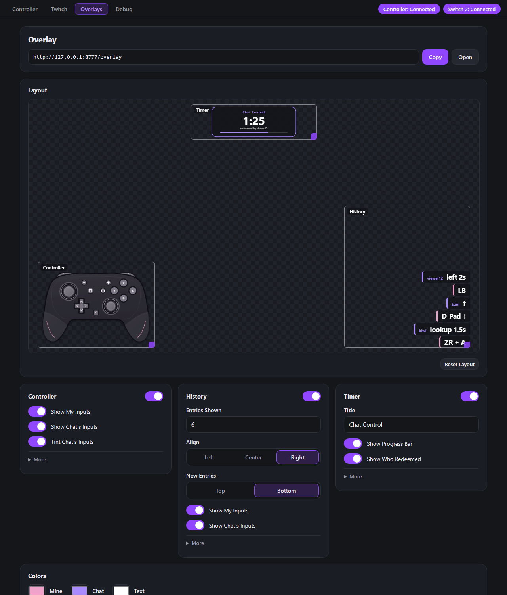
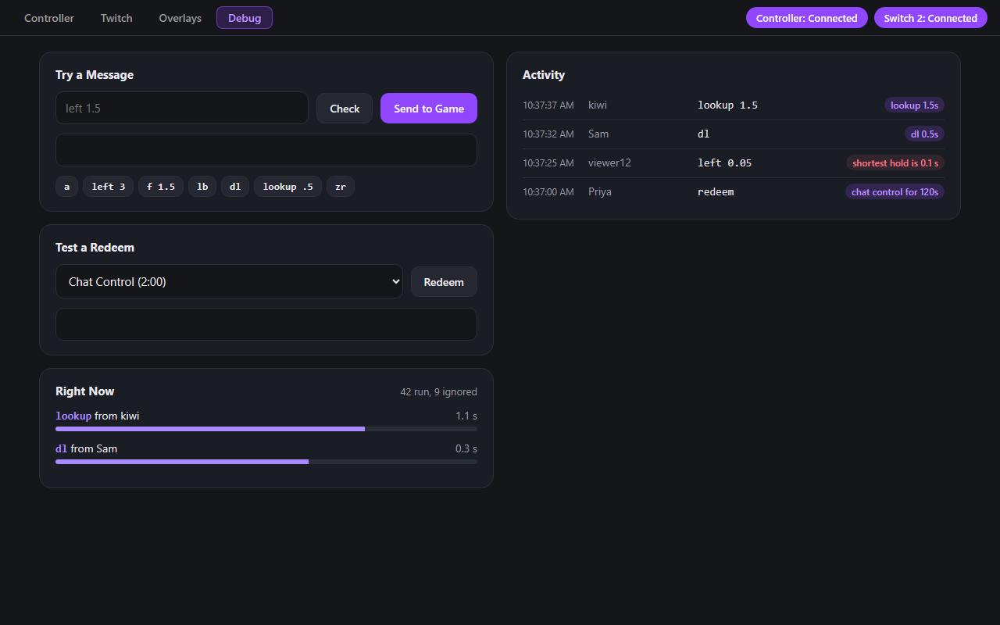
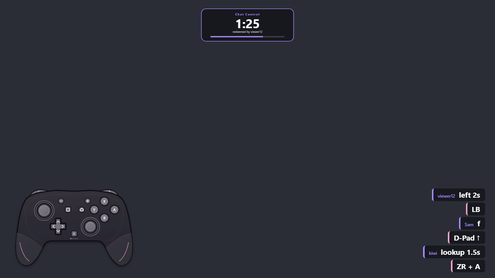
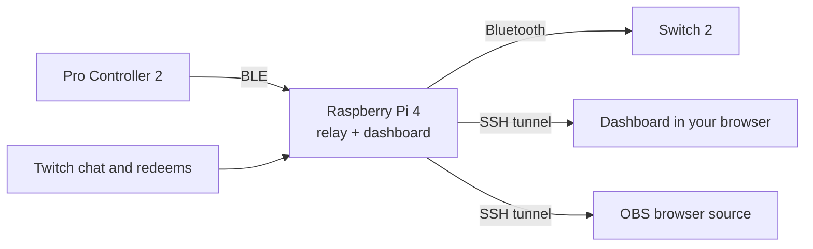

# PiS2CR

**Pi Switch 2 Controller Relay.** A Raspberry Pi 4 that sits between a real Switch 2 Pro Controller and a Switch 2. The controller connects to the Pi, and the Pi presents itself to the console as a controller. Every input passes through software, so it can be shown on screen, logged, and shared with Twitch chat.



> **Work in progress.** Rumble and LED passthrough are not covered yet, and latency has not been measured or published.

## Features

- **Relay** of buttons, both sticks, gyro, accelerometer and battery, with automatic reconnection after drops and reboots.
- **Dashboard** with a live controller view, motion, input history and click-to-press.
- **OBS overlay** with the controller, input history and a chat-control timer. Drag, resize and recolour it live.
- **Twitch chat control** through chat commands and channel point redeems, with access rules and limits.
- **Macros** played by the Pi with exact timing, with a seek bar and chat keyword triggers.

| | |
|---|---|
|  |  |
|  |  |



## Requirements

- Raspberry Pi 4 with Raspberry Pi OS Lite 64-bit (Debian 13), on your network. In Raspberry Pi Imager, set a username and password and turn on SSH.
- A Switch 2 and a Switch 2 Pro Controller.
- A Windows PC with a browser and the OpenSSH client (built into Windows 10 and 11).
- For Twitch features, your own Twitch developer application.

## Setup

1. Download `PiS2CR.exe` from the [latest release](https://github.com/LuunaVR/P2S2CR/releases/latest), or build it yourself with `launcher/build.ps1` (needs Python). The exe is not code-signed, so Windows may warn on first run.
2. Run `PiS2CR.exe`. On first run it opens a setup page.
3. Press **Find My Pi** (or type its address), enter the Pi's username and password. The password is used once and never saved. Setup creates an SSH key for later logins.
4. Press install. The first install takes several minutes because the Switch backend is built on the Pi.
5. Pair the Switch 2 (Controllers, then Change Grip/Order), then pair the controller (hold its sync button).
6. Open the dashboard. Later runs of `PiS2CR.exe` go straight to it.

Without the exe, copy the repo to `~/pis2cr` on the Pi and run:

```
sudo bash ~/pis2cr/deploy/install.sh
sudo bash ~/pis2cr/deploy/pair-switch.sh
sudo bash ~/pis2cr/deploy/pair-controller.sh
```

Then open an SSH tunnel and browse to `http://127.0.0.1:8000/`:

```
ssh -N -L 8000:127.0.0.1:8000 <your-pi>
```

For OBS, add a Browser Source with `http://127.0.0.1:8000/overlay`, size 1920 x 1080, transparent background. Details of what the installer does and how to repair a Pi are in [docs/rebuild.md](docs/rebuild.md).

## Twitch

1. Register an application in the [Twitch developer console](https://dev.twitch.tv/console). Client type **Public**, OAuth redirect URL `http://localhost`.
2. Set your client ID in `CLIENT_ID` in `tools/pro2_twitch.py`, or set `PIS2CR_TWITCH_CLIENT_ID` for the relay service. A client ID is not a secret.
3. Open the Twitch tab, press **Connect**, and approve the code on twitch.tv.

Chat control is off by default. Commands, redeem rules, access limits and macros are covered in [docs/chat-control.md](docs/chat-control.md).

## Development

```
cd tools
python -m unittest test_pro2_chat test_pro2_history test_pro2_macro test_pro2_overlay_settings test_pro2_twitch
cd ../launcher
python -m unittest test_launcher test_setup
```

The relay and stream modules need Linux (raw Bluetooth sockets), so run those on the Pi.

| Path | Contents |
|---|---|
| `tools/` | Relay, dashboard, overlay, chat control, Twitch and macro modules, plus protocol probes. |
| `deploy/` | Installer, pairing scripts, systemd units and the backend patch. |
| `launcher/` | `PiS2CR.exe` (SSH tunnel) and the browser setup wizard. |
| `fun/ocarina/` | Optional PC-side tools that turn a song into a macro. |
| `docs/` | [Feasibility notes](docs/feasibility.md), [rebuild guide](docs/rebuild.md), [chat control](docs/chat-control.md). |

## License

Free to use, modify and share for **noncommercial** purposes only. It cannot be sold, including modified versions, and anyone you share it with is bound by the same terms. See [LICENSE](LICENSE) (PolyForm Noncommercial 1.0.0).

The gyro and battery patch in `deploy/` modifies [wozt/pcble2gamepad](https://github.com/wozt/pcble2gamepad) (GPL-3.0) and stays under that license. Protocol references: ndeadly/switch2_controller_research, trevlars/switch2-controllers-linux and Dycool/NS-PC-Control.

Not affiliated with or endorsed by Nintendo or Twitch.
